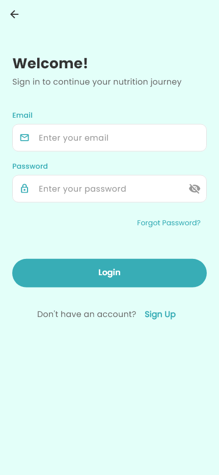
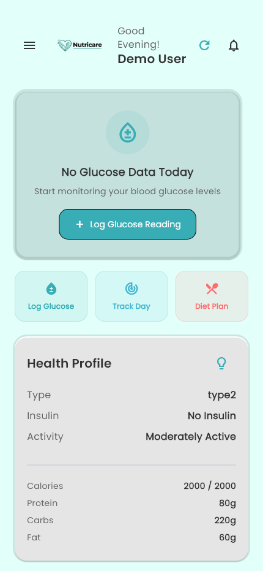
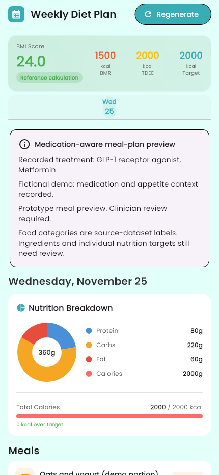
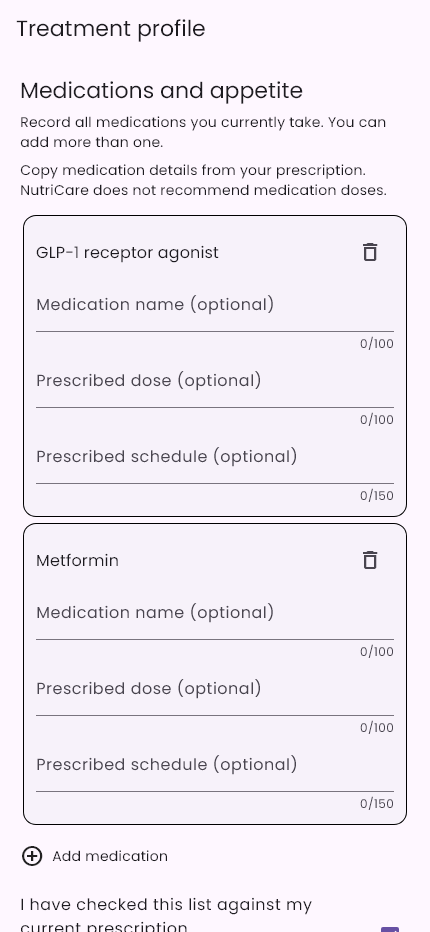
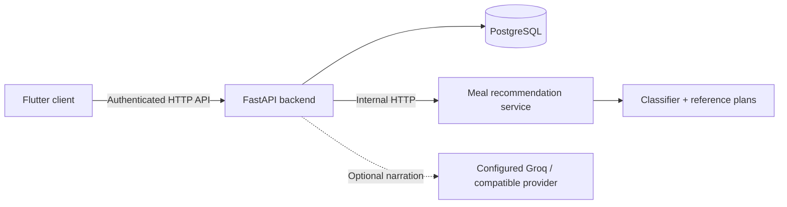

# NutriCare

**A full-stack nutrition and glucose-tracking prototype built with Flutter, FastAPI and PostgreSQL.**

NutriCare connects a mobile interface to authenticated APIs, longitudinal health records, a meal-recommendation service and optional AI report narration. Developed as a final-year project, it is an engineering demonstration—not a clinically validated diabetes-management product.

## App preview

These images render the actual Flutter screens at phone width using fictional fixture values. They are not photographs from a device and do not show patient records.

| Sign in | Dashboard |
|---|---|
|  |  |

| Meal-plan preview | Treatment profile |
|---|---|
|  |  |

## What the project demonstrates

- **Frontend/API integration:** Flutter onboarding, dashboard, treatment editing, tracking, meal plans and reports connected to FastAPI services.
- **Authentication and ownership:** JWT access/refresh sessions, password hashing, authenticated profile/report flows and cross-account access checks.
- **Database workflows:** SQLAlchemy/asyncpg models, PostgreSQL persistence, atomic glucose synchronization and user/date uniqueness.
- **Medication context:** multiple medication classes, including insulin, GLP-1 and combination therapy; appetite/symptoms are recorded without recommending medication doses.
- **Recommendation engineering:** an existing classifier plus explicit preference/nutrition filters and documented context-ranking rules. Unsatisfied constraints return a clear error instead of silently selecting incompatible meals.
- **Client state:** secure mobile session storage, per-user meal caching and invalidation after relevant profile/tracker changes.
- **Verification and packaging:** backend/ML/Flutter tests, a local PostgreSQL-to-ML smoke check, Docker packaging and an installable Android demo build.

## Architecture



| Component | Location | Technology |
|---|---|---|
| Mobile/web client | [`mobile/`](mobile/) | Dart, Flutter, HTTP, secure storage |
| Backend | [`backendApiNutricare NEW/backendApiNutricare NEW/`](backendApiNutricare%20NEW/backendApiNutricare%20NEW/) | FastAPI, SQLAlchemy, asyncpg, PostgreSQL |
| Recommendation service | [`Diet_Plan_AI_Complete_v3/`](Diet_Plan_AI_Complete_v3/) | pandas, scikit-learn, FastAPI |
| Deployment | `Dockerfile`, `deploy/`, `render.yaml` | Docker; optional hosting configuration |

The container exposes the backend only; its meal service binds to loopback. The Flutter client calls the backend rather than accessing the database or a provider key directly.

## Android interview demo

[Download demo APKs](https://github.com/sammihere2001/NutriCare/releases) and follow [the USB demo guide](docs/ANDROID_DEMO.md).

The demo uses the laptop's backend via USB port forwarding. **Installing the APK does not make the backend run on the phone.** The laptop and PostgreSQL must stay running. No always-on hosted deployment is claimed. The APK is debug-signed and labelled **NutriCare Demo**; it is not a Play Store release.

## Run locally

Requirements: Python 3.14, PostgreSQL, Flutter 3.38.5/Dart 3.10 and the Android SDK for APK builds. Keep secrets in the backend `.env`; an example is provided there. The original directory names are retained to keep the existing deployment scripts compatible.

1. Create Python virtual environments for the backend and ML directories. Install the backend `requirements.txt` and `deploy/requirements-ml.txt` into the relevant environments; the ML API also needs FastAPI, Pydantic and Uvicorn.
2. Configure a development `DATABASE_URL` and strong `JWT_SECRET` in the backend `.env`. Create/migrate the schema and populate reference lookups/foods using `app.scripts.seed_demo`; for local seeding, set `MEAL_DATASET_PATH` to the CSV in the ML directory. Use a new demo database.
3. Run the ML service from its directory:

   ```sh
   python -m uvicorn api:app --host 127.0.0.1 --port 8002
   ```

4. Run the backend from its directory:

   ```sh
   python -m uvicorn app.main:app --host 127.0.0.1 --port 8000
   ```

5. Run Flutter from `mobile/`:

   ```sh
   flutter pub get
   flutter run -d chrome --dart-define=API_BASE_URL=http://127.0.0.1:8000
   ```

Backend docs: `http://127.0.0.1:8000/docs`. Readiness: `http://127.0.0.1:8000/health/ready`.

For the container/hosting workflow, see [HOSTED_DEMO_SETUP.md](HOSTED_DEMO_SETUP.md). Render previously required card verification for the demo account; no live URL is advertised. Third-party free-tier eligibility/quotas are not guaranteed.

## Tests

From the backend or ML directory, using its configured environment:

```sh
python -m unittest discover -s tests -v
```

From `mobile/`:

```sh
flutter test test/foundation_test.dart test/treatment_test.dart test/portfolio_screenshots_test.dart
```

The tests cover ownership, session/cache races, medication persistence, nutrition constraints, provider fallbacks and short meal-plan rendering. Existing analyzer warnings and optional integration gaps remain. The screenshot generator is opt-in:

```sh
flutter test --dart-define=GENERATE_PORTFOLIO_SCREENSHOTS=true --update-goldens test/portfolio_screenshots_test.dart
```

## Data and model boundaries

The project owner confirmed on **2026-11-25** that the included original profile dataset is **synthetic**, not real patient records. See [the data/model card](docs/DATA_AND_MODEL_CARD.md). Its original creation methodology has not been independently verified. Do not substitute real patient records into this public repository.

Medication-aware ranking currently uses explicit engineering rules around the original classifier. It is **not** a separately clinically trained GLP-1 model. Optional reviewed-example training code is included, but no clinician-reviewed medication ranker has been installed. Meal portions, nutrients, dietary labels and clinical suitability still need professional review.

Optional Groq narration is disabled without configuration and falls back to recorded statistics. AI prose is labelled an unverified draft; no generated clinical risk/health score is accepted. See [provider setup](ANALYSIS_PROVIDER_SETUP.md).

Remaining work includes physical-device verification, production signing, password-reset deep links, optional SMTP/Cloudinary configuration, dependency cleanup, hosted deployment, reviewed data and diabetologist review. This prototype must not be used to change medication or insulin doses.
